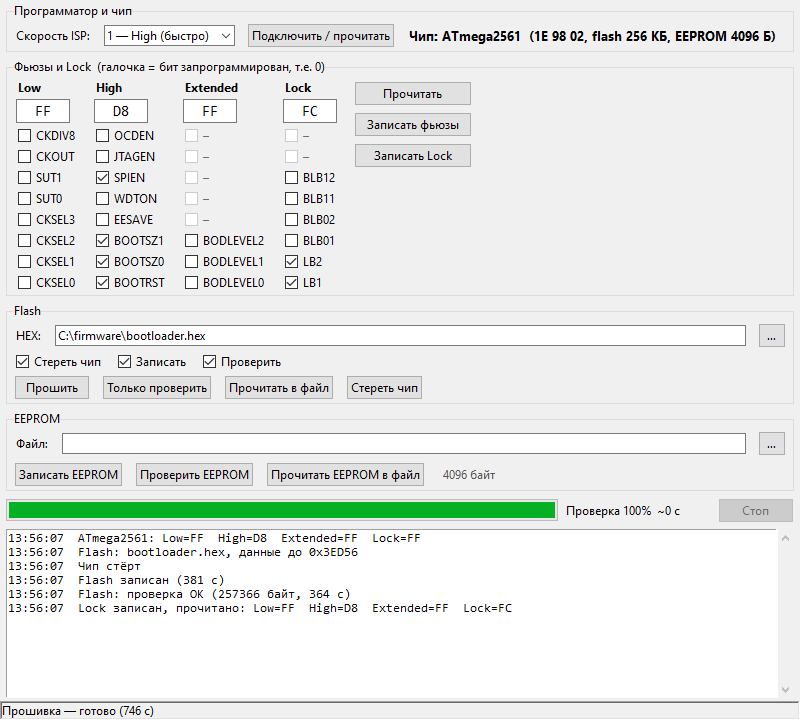

# ZF-ISP

Прошивальщик AVR-микроконтроллеров для китайского USB-программатора **ZhiFeng USBISP** (ПО PROGISP), работающий **без PROGISP** и без его ошибок.

*English: a standalone Windows GUI for the ZhiFeng/"zhifengsoft" HID USB-ISP AVR programmer (VID 03EB, PID C8B4), normally used with PROGISP. Reads/writes fuses, lock bits, flash and EEPROM of 128 ISP-capable AVR signatures. Use at your own risk — see the disclaimer below.*



## С каким программатором работает

Только с программатором, который в Windows определяется так:

| Параметр | Значение |
|---|---|
| Тип устройства | HID (драйвер не нужен) |
| VID / PID | **`03EB` / `C8B4`** (`HID\VID_03EB&PID_C8B4`) |
| Производитель (строка USB) | `zhifengsoft` |
| Продукт (строка USB) | `USBHID` |
| Родное ПО | PROGISP (ZhiFeng Software) |

Проверено с программатором, который PROGISP 1.72 опознаёт как **«ZF-008 HV Programmer Ver:1.6»**. Другие программаторы (USBasp, AVRISP mkII, Atmel-ICE и т.п.) **не поддерживаются** — для них есть avrdude/AVRDUDESS.

Проверить, что у вас именно такой: Диспетчер устройств → «Устройства HID» → свойства → ИД оборудования должен содержать `VID_03EB&PID_C8B4`.

## Что умеет

- определение чипа по сигнатуре — **128 сигнатур** (176 моделей) с интерфейсом ISP, см. список ниже;
- фьюзы Low / High / Extended и Lock: ввод в hex **или галочками по битам** с названиями (CKDIV8, SPIEN, BOOTRST, BODLEVEL…), запись с проверкой;
- защита от «окирпичивания»: нельзя снять **SPIEN** и включить **RSTDISBL** (после этого ISP перестаёт работать), предупреждения для **DWEN** и **JTAGEN**;
- Flash: стирание, запись, проверка, чтение в Intel HEX; поддержка flash > 128 КБ (ATmega2560/2561);
- EEPROM: запись (с проверкой), проверка, чтение в файл (.eep / .hex);
- выбор скорости ISP (5 уровней), прогресс-бар с оставшимся временем, журнал, кнопка «Стоп».

### Чем лучше PROGISP

При работе с ATmega2561 в PROGISP 1.72 обнаружены ошибки, которых здесь нет:

1. **Extended-фьюз всегда записывается как `0x00`** (команда `AC A4 00 00`), что бы ни было в поле.
2. **Flash больше 128 КБ записывается неправильно**: не переключается расширенный адрес (`Load Extended Address`), верхняя и нижняя половины памяти накладываются → «Flash Verify Error».

## Установка и запуск

Скачайте `ZF-ISP.exe` со страницы [Releases](../../releases) и запустите — установка не нужна.

PROGISP при этом должен быть **закрыт** (иначе программатор занят).

### Порядок работы

1. Подключите программатор и плату, подайте питание на плату.
2. Нажмите **«Подключить / прочитать»** — появятся модель чипа и фьюзы.
3. Для **нового** чипа (с завода он работает от внутреннего генератора 1 МГц) выберите скорость **5 — Low**, иначе чип может не ответить. После перевода фьюзов на кварц можно ставить High.
4. Выберите HEX и нажмите **«Прошить»** (стирание → запись → проверка). EEPROM — в отдельном блоке.
5. **Lock-биты ставьте последним шагом** — после них чтение и проверка невозможны. Снимаются только стиранием чипа.

## Сборка из исходников

```bash
pip install -r requirements.txt pyinstaller
python zfisp.py                      # запуск без сборки
python -m PyInstaller --onefile --windowed --name ZF-ISP --collect-binaries hid zfisp.py
```

Таблица чипов `chips_db.py` генерируется из файлов [AVRDUDESS](https://github.com/ZakKemble/AVRDUDESS) (`avrdude.conf` + `bits.xml`):

```bash
python gen_chips.py "C:\Program Files (x86)\AVRDUDESS"
```

SPI-команды каждого чипа (чтение/запись flash, EEPROM, фьюзов) берутся из шаблонов `avrdude.conf`, поэтому работают и «нестандартные» чипы (ATtiny, старые AT90S).

## Протокол программатора

Найден перехватом обмена PROGISP ↔ программатор. Все пакеты — HID feature report, ID 1, 8 байт.

| Команда | Пакет | Назначение |
|---|---|---|
| Вход в ISP | `01 0D 01 <spd> 20 A0 40 C0`, затем `01 0D 00 <spd> 20 A0 40 C0` | `spd` = 1 (быстро) … 5 (медленно) |
| ISP-команда | `01 0E <b0> <b1> <b2> <b3> 00 04` | любая 4-байтная команда AVR Serial Programming |
| Ответ | GetFeature(ID 1) → байты 0..3 | ответ SPI (данные — в байте 3) |
| Выход из ISP | `01 0B 01 00 00 00 00 00` | отпустить RESET |

Важно: программатор **выполняет ISP-команду только при чтении ответа** (GetFeature). Команды без чтения ответа молча теряются.

PROGISP для записи flash использует блочный режим (report ID 2, 136 байт), здесь он не используется — запись идёт стандартными постраничными командами, поэтому медленнее (≈ 6 мин на 256 КБ + столько же на проверку), зато корректно.

## Поддерживаемые чипы

Все AVR из `avrdude.conf` (AVRDUDESS, avrdude 8.1) с режимом программирования ISP:

AT90CAN32, AT90CAN64, AT90CAN128, AT90PWM1, AT90PWM2, AT90PWM3, AT90PWM2B, AT90PWM3B, AT90PWM81, AT90PWM161, AT90PWM216, AT90PWM316, AT90S1200, AT90S2313, AT90S2323, AT90S2333, AT90S2343, AT90S4414, AT90S4433, AT90S4434, AT90S8515, AT90S8535, AT90USB82, AT90USB162, AT90USB646, AT90USB647, AT90USB1286, AT90USB1287, ATmega8, ATmega8A, ATmega8U2, ATmega8HVA, ATmega8515, ATmega8535, ATmega16, ATmega16A, ATmega16M1, ATmega16U2, ATmega16U4, ATmega16HVA, ATmega16HVB, ATmega16HVBrevB, ATmega32, ATmega32A, ATmega32C1, ATmega32M1, ATmega32U2, ATmega32U4, ATmega32HVB, ATmega32HVBrevB, ATmega32HVE2, ATmega48, ATmega48A, ATmega48P, ATmega48PA, ATmega48PB, ATmega64, ATmega64A, ATmega64C1, ATmega64M1, ATmega64HVE2, ATmega64RFR2, ATmega88, ATmega88A, ATmega88P, ATmega88PA, ATmega88PB, ATmega103, ATmega128, ATmega128A, ATmega128RFA1, ATmega128RFR2, ATmega161, ATmega162, ATmega163, ATmega164A, ATmega164P, ATmega164PA, ATmega165, ATmega165A, ATmega165P, ATmega165PA, ATmega168, ATmega168A, ATmega168P, ATmega168PA, ATmega168PB, ATmega169, ATmega169A, ATmega169P, ATmega169PA, ATmega256RFR2, ATmega324A, ATmega324P, ATmega324PA, ATmega324PB, ATmega325, ATmega325A, ATmega325P, ATmega325PA, ATmega3250, ATmega3250A, ATmega3250P, ATmega3250PA, ATmega328, ATmega328P, ATmega328PB, ATmega329, ATmega329A, ATmega329P, ATmega329PA, ATmega3290, ATmega3290A, ATmega3290P, ATmega3290PA, ATmega640, ATmega644, ATmega644A, ATmega644P, ATmega644PA, ATmega644RFR2, ATmega645, ATmega645A, ATmega645P, ATmega6450, ATmega6450A, ATmega6450P, ATmega649, ATmega649A, ATmega649P, ATmega6490, ATmega6490A, ATmega6490P, ATmega1280, ATmega1281, ATmega1284, ATmega1284P, ATmega1284RFR2, ATmega2560, ATmega2561, ATmega2564RFR2, ATtiny12, ATtiny13, ATtiny13A, ATtiny15, ATtiny22, ATtiny24, ATtiny24A, ATtiny25, ATtiny26, ATtiny43U, ATtiny44, ATtiny44A, ATtiny45, ATtiny48, ATtiny84, ATtiny84A, ATtiny85, ATtiny87, ATtiny88, ATtiny167, ATtiny261, ATtiny261A, ATtiny441, ATtiny461, ATtiny461A, ATtiny828, ATtiny828R, ATtiny841, ATtiny861, ATtiny861A, ATtiny1634, ATtiny1634R, ATtiny2313, ATtiny2313A, ATtiny4313.

**Не поддерживаются** (у них другой интерфейс, не ISP): ATtiny4/5/9/10 (TPI), XMEGA (PDI), ATmega серий 0/1/2 (ATmega4809, 3208 …), ATtiny 0/1/2-series, AVR-DA/DB/DD (UPDI).

Реально на железе проверены: **ATmega2561** (фьюзы, flash 256 КБ, lock) и **AT90USB1287** (фьюзы, EEPROM). Остальные чипы работают по описаниям из `avrdude.conf`, но лично не проверялись.

## Отказ от ответственности

Программа распространяется **«как есть» (AS IS), без каких-либо гарантий**, явных или подразумеваемых, включая гарантии пригодности для конкретной цели.

- Неправильная запись фьюзов, lock-битов или прошивки может сделать микроконтроллер **недоступным для ISP-программирования**, а устройство — неработоспособным. Восстановление может потребовать высоковольтного программатора или замены чипа.
- Автор **не несёт ответственности** за любой ущерб: испорченные микроконтроллеры, платы и устройства, потерю данных и прошивок, простои и любые иные прямые или косвенные последствия использования программы.
- Протокол программатора получен анализом обмена данными и **не документирован производителем**; поведение может отличаться на других версиях аппаратуры и прошивки программатора.
- Перед записью сохраняйте содержимое flash/EEPROM и значения фьюзов. Всю ответственность за использование программы вы берёте на себя.

Проект не связан с Microchip Technology / Atmel, ZhiFeng Software и авторами avrdude/AVRDUDESS. AVR, ATmega, ATtiny — товарные знаки Microchip Technology Inc.

## Лицензия

[GNU GPL v3](LICENSE).

Таблица чипов `chips_db.py` получена из `avrdude.conf` проекта [avrdude](https://github.com/avrdudes/avrdude) (GPL-2.0-or-later) и `bits.xml` проекта [AVRDUDESS](https://github.com/ZakKemble/AVRDUDESS) (GPL-3.0) — спасибо их авторам.
